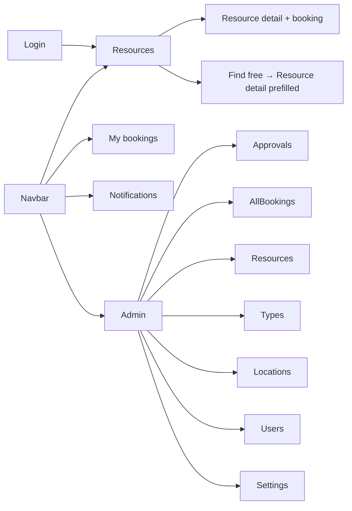
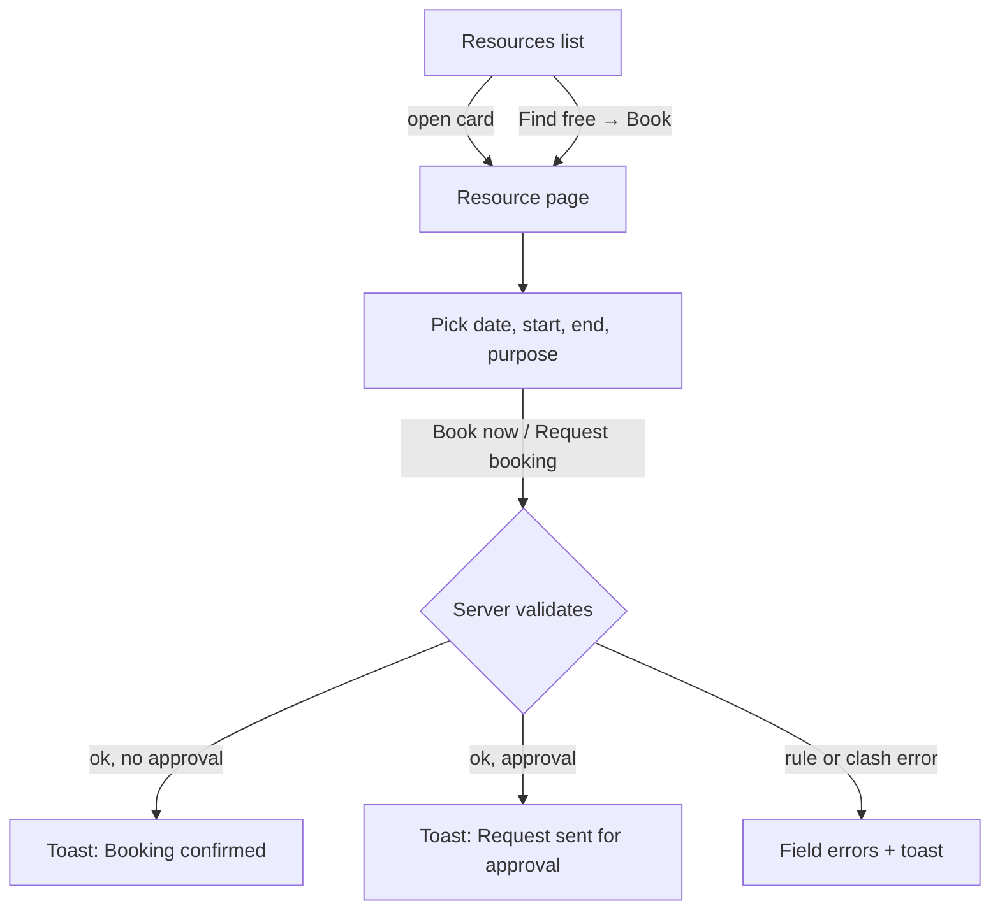
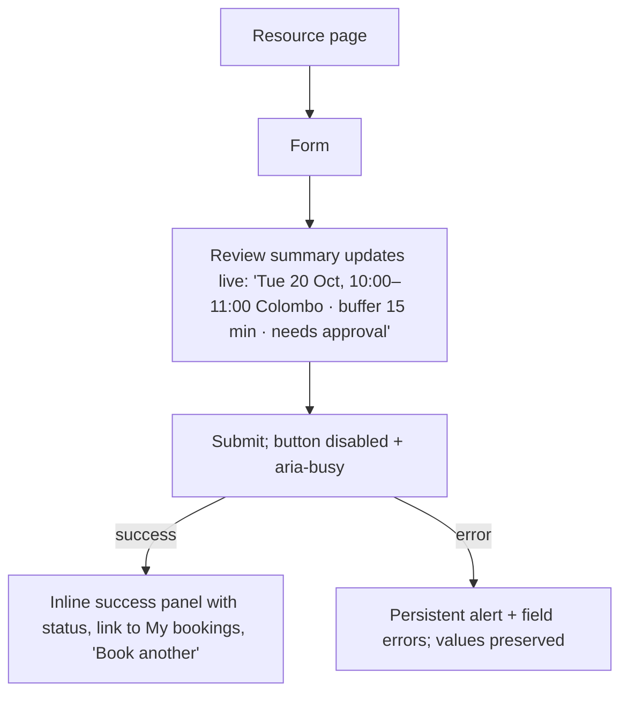

# UI/UX Design Specification — Resource & Facility Booking App

| | |
|---|---|
| Status | **Approved with constraints; Phases 1–5 implemented (see Section 17). Not verified in a browser or with assistive technology.** |
| Date | 2026-10-14 |
| Scope | Frontend of `booking-app` (Next.js 16 App Router, React 19, CSS Modules, FullCalendar) |
| Source brief | `RESOURCE_BOOKING_UI_UX_PROMPT.md` |

**Evidence labels used throughout**

- **[V] Verified** — read directly in the source code (file cited).
- **[A] Assumption** — inferred; not confirmed by running the app in a browser or with assistive technology.
- **[P] Proposal** — recommended change, not yet implemented.

> **Important disclosure.** Before this document was requested, a small first pass of visual changes was already applied to the code (tokens, badges with icons, nav active states, skip link, focus/hover states, toasts). Section 2 audits the code **as it is now** and marks which findings that pass already addressed ("Phase 0"). Nothing has been verified in a browser, with a screen reader, or with automated a11y tooling. **No WCAG conformance is claimed anywhere in this document.** Official reference pages (Section 4) were **not fetched** in this session; they are cited from prior knowledge and must be checked before being treated as verified.

---

## 1. Overview, scope, personas and goals

### 1.1 What the app is [V]
A booking system for shared physical resources (rooms, vehicles, equipment, tools). Key behaviours found in code:

- Resources belong to a **type** and a **location tree** (site → building → floor → area) (`admin/locations`).
- Booking **rules** cascade global → type → resource: working days/hours, slot size, max duration, buffer after booking, cancellation cut-off, approval required (`server/rules.ts`, `RulesFields`, resource page "Rules that apply").
- Bookings are **single or recurring series** (weekly / daily). Recurring requests are approved or rejected as one unit (`ApprovalItem`, approvals page subtitle).
- Statuses seen in UI: `pending`, `approved`, `rejected`, `cancelled`, `expired` (+ `maintenance`, `retired`, `active` for resources).
- All times are displayed in **Asia/Colombo** regardless of the browser zone (`ResourceCalendar`, `BookingTable` header "When (Colombo)").
- Double-booking is prevented in the DB; the UI explains clashes for series (`ClashList`).

### 1.2 Roles [V]
Permission strings seen: `resource:view`, `booking:view:own`, `booking:view:all`, `booking:approve`, `resource:manage`, `resource-type:manage`, `location:manage`, `settings:manage`, `user:manage-roles`. Two roles exist in the UI: **user** and **admin**. Admin area is gated by `booking:approve` (`admin/layout.tsx`).

### 1.3 Personas [A]
| Persona | Goals | Pain points to design against |
|---|---|---|
| **Requester** (staff member) | Find a free room/vehicle fast; book without surprises; see status; cancel | Not knowing *why* a slot is blocked; unclear approval wait; timezone doubt |
| **Approver / Admin** | Clear a queue of requests quickly and safely; see clashes; keep catalogue accurate | Deciding without context; accidental destructive actions; dense config tables |
| **New visitor** | Sign in/register | Demo credentials shown on login page (acceptable for demo only) |

### 1.4 Goals (from brief) and success measures
1. Booking efficiency — fewer steps/clicks from "I need X at time T" to a confirmed or requested booking.
2. Clarity of status — never rely on colour alone.
3. Accessibility — target WCAG 2.2 AA (to be **verified**, not asserted).
4. Responsive — usable 320–1440px without unintended horizontal scroll.
5. Maintainability — tokens centralised; no new heavy dependencies; no change to routes, actions, permissions, validation or business rules.

### 1.5 Explicitly out of scope
The brief mentions items this app does not have; they are **not** specified here: a dashboard page, a collapsible desktop sidebar for end users, a stepwise booking wizard, resource photos/amenity lists/ratings, user-facing policy pages, a conflict-management admin page, modification (edit/reschedule) of an existing booking. See Appendix A for the mapping.

---

## 2. Existing UI audit

### 2.1 Inventory [V]

**Routes**

| Route | Audience | Purpose | Main components |
|---|---|---|---|
| `/` | all | redirects to `/resources` | — |
| `/login`, `/register` | public | auth | `AuthForm` |
| `/resources` | user+ | browse/filter, "find free" | `FindFreeForm`, `ResourceFilters`, `ResourceCard`, `Pagination` |
| `/resources/[id]` | user+ | calendar, book, rules, details | `ResourceCalendar`, `BookingForm`, `Card` |
| `/bookings` | user+ | own bookings (tabs) | `Tabs`, `BookingTable` |
| `/notifications` | user+ | notification list | `ActionButton`, `Badge` |
| `/admin/approvals` | admin | decide pending single/series | `ApprovalItem` |
| `/admin/bookings` | admin | all bookings + filters | `BookingTable showUser`, filter form |
| `/admin/resources` | admin | CRUD resources (retire) | `ResourceForm`, `Table` |
| `/admin/resource-types` | admin | rule defaults per type | `RulesFields`, `Table` |
| `/admin/locations` | admin | location tree | `LocationPicker`, `Table` |
| `/admin/users` | admin | promote/demote | `Table`, `ActionButton` |
| `/admin/settings` | admin | global rule defaults | `RulesFields` |

**Shared UI** (`src/components/ui`): Button/LinkButton, Input/Textarea/Select/Checkbox, FormField, ActionForm/SubmitButton, ActionButton (with native `<dialog>` confirm), Badge, Card, Table, Tabs (link-based), Pagination (prev/next links), EmptyState, Toast. **Layout**: AppShell, Navbar, NavLinks (new), AdminSidebar, PageHeader, SignOutButton. **Styling**: CSS Modules + CSS variables in `styles/globals.css`; no UI library.

### 2.2 Severity scale
Critical = blocks a task or excludes a user group; High = significant usability/a11y barrier; Medium = noticeable friction; Low = polish.

### 2.3 Findings

| ID | Sev | Finding | Evidence | Pages | Proposal | Status |
|---|---|---|---|---|---|---|
| A-01 | **High** | **Input/control border contrast is below 3:1.** `--border-strong: #94a3b8` on white = **2.56:1** (computed in this session). Fails the WCAG 1.4.11 non-text-contrast target for form control boundaries. Introduced by Phase 0. | `globals.css`, `Input.module.css` | all forms | Change `--border-strong` to `#64748b` (≈4.76:1 on white, computed) [P] | Open — regression from Phase 0 |
| A-02 | **High** | **Calendar uses hard-coded old hex colours and colour-only distinction** for own/other/pending/buffer. Pending has a text prefix ("Pending ·"), the others rely on colour + title text only. Legend is colour swatches. | `ResourceCalendar.tsx` `COLORS`, legend | `/resources/[id]` | Move colours to tokens; add pattern/border/icon per kind (e.g. dashed border for pending, hatch for buffer) and a text legend [P] | Open |
| A-03 | **High** | **Calendar is the only way to see free slots; not keyboard/screen-reader friendly** (FullCalendar time grid; events may be focusable but empty slots aren't selectable; no list alternative). Users must type times manually in the form. | `ResourceCalendar.tsx`, `BookingForm.tsx` | `/resources/[id]` | Add an accessible "Bookings this week" list/table alternative under the calendar; keep form as the booking mechanism [P]. Click-to-prefill is optional/later | Open |
| A-04 | **High** | **Booking form gives no pre-submit guidance about availability.** User picks date/start/end blind; conflicts are only discovered after submit (series shows `ClashList`; single booking shows a toast only). | `BookingForm.tsx` | `/resources/[id]` | Add a pre-submit summary ("Review") line (resource, local date, duration, approval/no-approval, buffer), and inline persistent error for single-booking conflicts, not toast-only [P] | Open |
| A-05 | **Medium** | **Errors for single bookings are toast-only** (auto-dismiss after 5 s). Field errors are shown inline but the general error disappears. | `ActionForm.tsx`, `Toast.tsx` | booking, admin forms | Keep toast, add persistent `role="alert"` summary above the submit button for non-field errors [P] | Open |
| A-06 | **Medium** | **Toast region is `aria-live="polite"` with fixed 5 s timeout, no dismiss, no pause on hover/focus.** WCAG 2.2.1 (timing) concern for long messages. Error toasts now `role="alert"` (Phase 0). | `Toast.tsx` | global | Add dismiss button; pause timer on hover/focus; errors persist until dismissed [P] | Partly addressed |
| A-07 | **Medium** | **Mobile navigation** wraps the 3 links onto a second row (`flex-wrap`); acceptable now, but "Notifications" text label + user name + Sign out crowd the bar at ≤480px [A]. | `Navbar.module.css` | all | Collapse secondary items into a menu `
`/disclosure under 640px [P] | Open |
| A-08 | **Medium** | **Admin sidebar becomes a wrapped link row on mobile**; 7 links wrap to several lines and push content down. | `AdminSidebar.module.css` | `/admin/*` | Horizontal scroll-snap nav or disclosure "Admin menu" under 760px [P] | Open |
| A-09 | **Medium** | **Wide tables** (`resource-types` has 9 columns, bookings 6) rely on `overflow-x:auto` wrapper. No sticky first column or stacked mobile layout. | `Table.module.css`, pages | bookings, admin | Mobile: card-list rendering for `BookingTable` (≤640px); keep scroll for config tables with visible scroll affordance [P] | Open |
| A-10 | **Medium** | **Approval row layout** puts a 240px-wide note input + two buttons in a `.row`; on narrow screens it wraps unpredictably. Reject requires a note but this isn't explained until the button is disabled. | `ApprovalItem.tsx` (`style={{width:240}}`) | `/admin/approvals` | Stack layout; helper text "Required to reject"; show the note as a labelled textarea; `aria-describedby` on Reject [P] | Open |
| A-11 | **Medium** | **Inline styles exist** (`width:240`, `paddingLeft`, `color: var(--warn)`, `alignSelf`) bypassing tokens. | `ApprovalItem.tsx`, `locations/page.tsx` | admin | Replace with CSS-module classes [P] | Open |
| A-12 | **Medium** | **Filter forms are GET forms with no applied-filter summary or "Clear" action**; empty state says "Try clearing a filter" but there is no clear link. | `ResourceFilters.tsx`, `resources/page.tsx` | `/resources`, `/admin/bookings` | Add "Clear filters" link and chips of active filters [P] | Open |
| A-13 | **Medium** | **"Find free resources" and the filters are two separate large forms stacked above results**, pushing results below the fold on laptops [A]. | `resources/page.tsx` | `/resources` | Collapse "Find free" into a disclosure (default closed unless used) [P] | Open |
| A-14 | Low | **Location `<select>` indentation** already uses non-breaking spaces, so hierarchy is preserved visually; screen readers do not announce depth. [V] My earlier claim that spaces collapse was wrong. | `LocationPicker.tsx` | resources, admin | No change | Closed (finding withdrawn) |
| A-15 | **Medium** | **Label association inconsistent.** `FormField` wraps control in `<label>` (good). `AuthForm` also wraps; `ResourceFilters`/admin filters use `aria-label` only (acceptable, no visible label). Radio group in `BookingForm` has `role="radiogroup"` but radios lack a `name` and the group uses `aria-label` only. | `FormField.tsx`, `BookingForm.tsx` | forms | Give radios a shared `name`, use `<fieldset><legend>`; add visible labels on filter inputs at ≥768px [P] | Open |
| A-16 | **Medium** | **Pagination is Prev/Next only** with plain "Page X of Y"; no `<nav aria-label>`; disabled state is a muted `span`. | `Pagination.tsx` | resources, admin bookings | Wrap in `<nav aria-label="Pagination">`, add `aria-disabled`, show total range [P] | Open |
| A-17 | **Medium** | **Tabs are links without `aria-current`** (visual active state only). | `Tabs.tsx` | `/bookings` | Add `aria-current="page"`, `aria-label` on nav [P] | Open |
| A-18 | **Medium** | **Confirm dialog**: native `<dialog>` (good: focus trap, Esc). Buttons "Keep" / "Confirm" are generic; no `aria-labelledby`; focus return not explicitly handled [A]. | `ActionButton.tsx` | all destructive actions | Specific labels ("Cancel booking" / "Keep booking"), `aria-labelledby`, verify focus returns to trigger [P] | Open |
| A-19 | **Low** | **Page titles are static** (`metadata.title` only in root layout) — every page's `<title>` is "Resource Booking"; hurts orientation and screen-reader page announcements (WCAG 2.4.2). | `app/layout.tsx` | all | Per-route `metadata`/`generateMetadata` ("My bookings · Resource Booking") [P] | Open |
| A-20 | **Low** | **`PageHeader` uses `.row`**, so on narrow screens actions wrap beside the title unpredictably. | `PageHeader.tsx` | all | Dedicated layout: title block + actions, stacked <640px [P] | Open |
| A-21 | **Low** | **Demo credentials printed on the login page.** Fine for the assessment demo; should be gated for production. | `login/page.tsx` | login | Show only when `NODE_ENV !== "production"` [P] | Open |
| A-22 | **Low** | **No loading/skeleton states** (`loading.tsx` absent from route tree). Pages are server-rendered; navigation shows nothing until ready [V: no `loading.tsx` in file list]. | file tree | all | Add `loading.tsx` skeletons for `/resources`, `/resources/[id]`, `/bookings`, `/admin/*` [P] | Open |
| A-23 | **Low** | **No `error.tsx` / `not-found.tsx` custom UI** in file tree; users see framework defaults. | file tree | all | Add friendly error/404 pages with a path back [P] | Open |
| A-24 | **Low** | **Notification link in navbar is text-only** ("Notifications 3"); unread count has accessible label (good) but the visible word + badge consumes width on mobile. | `Navbar.tsx` | all | Icon + count on small screens, label retained for AT [P] | Open |
| A-25 | **Low** | **Native `datetime-local`/`time`/`date` inputs** used. Accessible and mobile-friendly, but inconsistent across browsers; `step` enforces slot size only via validity UI. | `BookingForm.tsx`, `FindFreeForm.tsx` | booking | Keep native (brief: prefer existing accessible components). Document the behaviour; add helper text [P] | Accept |
| A-26 | **Low** | **Buttons rely on text only ("Working…") for pending;** no spinner and no `aria-busy`. Double-submit is prevented (button disabled while pending) [V]. | `ActionForm.tsx`, `ActionButton.tsx` | all | Add `aria-busy`, optional inline spinner [P] | Partly OK |
| A-27 | **Positive** | Double-submit protection, preserved form values on server error (uncontrolled inputs are not reset), confirm dialogs for cancel/retire/delete/role change, `lang="en"`, native semantic elements, link-based tabs and filters keep state in the URL. | various | — | Keep | — |

### 2.4 Phase 0 — already applied (for traceability) [V]
Tokens refreshed to the brief's palette; radius/shadow/spacing tokens; Badge now icon + text; button/input min-height 40px, hover and focus states; form error prefix + `role="alert"`; toast icons and error `role="alert"`; navbar `NavLinks` with `aria-current`; admin sidebar `aria-current`/labels; skip link; `prefers-reduced-motion` rule; card/table/dialog polish. Checks run after Phase 0: TypeScript, ESLint and the 11 unit tests passed. **No visual/browser verification was done.**

---

## 3. Design principles and rationale

| # | Principle | Rationale / heuristic |
|---|---|---|
| 1 | **Show system status** — status always as text + icon + colour | Nielsen #1; WCAG 1.4.1 |
| 2 | **Prevent, then explain, conflicts** — surface rules before submit, explain after | Nielsen #5, #9 |
| 3 | **One obvious primary action per view** | Nielsen #8; ISO 9241-110 "suitability for the task" |
| 4 | **Consistency** — one token set, one component per job | Nielsen #4; ISO 9241-110 "conformity with expectations" |
| 5 | **Forgiving** — preserve input, confirm consequential actions, no data loss | Nielsen #3, #5; ISO "error tolerance" |
| 6 | **Recognition over recall** — filters shown as chips, rules visible beside the form | Nielsen #6 |
| 7 | **Restrained** — subtle borders, minimal shadow, limited motion | brief §3 |
| 8 | **Time is unambiguous** — always show Colombo zone next to times | domain risk |

---

## 4. Standards and official references

> **Not verified in this session** — the sites were not fetched. Cited from prior knowledge; re-check before relying on specifics.

| Reference | URL |
|---|---|
| WCAG 2.2 | https://www.w3.org/TR/WCAG22/ |
| WCAG 2.2 "What's new" | https://www.w3.org/WAI/standards-guidelines/wcag/new-in-22/ |
| WAI-ARIA Authoring Practices (dialog, tabs, disclosure) | https://www.w3.org/WAI/ARIA/apg/ |
| Material Design 3 | https://m3.material.io/ |
| Apple Human Interface Guidelines | https://developer.apple.com/design/human-interface-guidelines/ |
| Nielsen's 10 usability heuristics | https://www.nngroup.com/articles/ten-usability-heuristics/ |
| ISO 9241-110 (interaction principles) | https://www.iso.org/standard/75258.html |
| Next.js docs (this repo's pinned copy; AGENTS.md says read it first) | `node_modules/next/dist/docs/` |

**How they are used:** WCAG 2.2 AA is the acceptance baseline; Nielsen + ISO 9241-110 guide interaction decisions; Material 3 informs state layers and component anatomy; Apple HIG informs target sizes and mobile patterns. Visual styles are **not** mixed.

---

## 5. Navigation and information architecture

### 5.1 Current [V]

### 5.2 Proposal [P]
- Keep the **top bar for end users** (3–4 destinations does not justify a sidebar — a deliberate deviation from the brief's "collapsible sidebar", which suits larger IAs). Keep the **left sidebar for admin** (7 destinations), made collapsible to an icon/short-label rail ≥1024px and a disclosure menu <760px.
- Group admin links: **Operations** (Approvals, All bookings) · **Catalogue** (Resources, Resource types, Locations) · **System** (Users, Settings).
- Contextual header: page title (h1), one-line subtitle, primary action right-aligned (desktop) / below (mobile).
- Breadcrumb on resource detail: `Resources › {Location} › {Resource}` [P].
- Pending count badge on the admin "Approvals" link [P] (data already available via `listPending`).

### 5.3 Keyboard / screen-reader behaviour
| Element | Requirement |
|---|---|
| Skip link | First tab stop, jumps to `#main` (done in Phase 0) |
| Landmarks | `header`, `nav[aria-label=Main]`, `aside[aria-label=Admin]`, `main#main` |
| Current page | `aria-current="page"` (done for navbar/admin; to do for tabs, pagination) |
| Disclosure menus | Button with `aria-expanded`/`aria-controls`; Esc closes; focus returns |
| Route change | Focus moves to `main` or `h1`; document title updates (A-19) |

---

## 6. Semantic colour tokens and contrast matrix

### 6.1 Tokens (current values in `globals.css`) [V]
| Token | Value | Role |
|---|---|---|
| `--bg` | `#f8fafc` | app background |
| `--surface` | `#ffffff` | cards, forms, dialogs |
| `--surface-muted` | `#f1f5f9` | table header, hover |
| `--border` | `#e2e8f0` | decorative dividers |
| `--border-strong` | `#94a3b8` → **proposed `#64748b`** | control boundaries |
| `--text` | `#0f172a` | body/headings |
| `--muted` | `#475569` | secondary text |
| `--primary` / `-hover` / `-soft` | `#2563eb` / `#1d4ed8` / `#dbeafe` | actions, selection |
| `--primary-text` | `#1d4ed8` | links/active text |
| `--secondary` | `#0f766e` | accents (defined, not yet used) |
| `--success` / `-soft` | `#15803d` / `#dcfce7` | confirmed |
| `--warn` / `-soft` | `#b45309` / `#fef3c7` | pending |
| `--danger` / `-soft` | `#b91c1c` / `#fee2e2` | error/destructive |

### 6.2 Contrast matrix — **computed** in this session with the WCAG relative-luminance formula (not measured in a browser)
| Pair (foreground on background) | Ratio | Requirement | Result |
|---|---|---|---|
| text `#0f172a` on bg `#f8fafc` | 17.06 | 4.5 | Pass |
| text on surface `#fff` | 17.85 | 4.5 | Pass |
| muted `#475569` on `#fff` | 7.58 | 4.5 | Pass |
| muted on bg `#f8fafc` | 7.24 | 4.5 | Pass |
| muted on surface-muted `#f1f5f9` | 6.92 | 4.5 | Pass |
| muted on primary-soft `#dbeafe` | 6.21 | 4.5 | Pass |
| white on primary `#2563eb` | 5.17 | 4.5 | Pass |
| white on primary-hover `#1d4ed8` | 6.70 | 4.5 | Pass |
| primary-text `#1d4ed8` on `#fff` | 6.70 | 4.5 | Pass |
| primary-text on primary-soft | 5.49 | 4.5 | Pass |
| success `#15803d` on success-soft `#dcfce7` | 4.57 | 4.5 | Pass (thin margin) |
| warn `#b45309` on warn-soft `#fef3c7` | 4.51 | 4.5 | Pass (thin margin) |
| danger `#b91c1c` on danger-soft `#fee2e2` | 5.30 | 4.5 | Pass |
| white on danger `#b91c1c` | 6.47 | 4.5 | Pass |
| white on success `#15803d` | 5.02 | 4.5 | Pass |
| secondary `#0f766e` on `#fff` | 5.47 | 4.5 | Pass |
| focus/primary `#2563eb` on `#fff` | 5.17 | 3.0 (non-text) | Pass |
| **border-strong `#94a3b8` on `#fff`** | **2.56** | 3.0 (control boundary) | **FAIL** (A-01) |
| decorative `--border #e2e8f0` on `#fff` | 1.23 | n/a (decorative) | Allowed only if not the sole indicator of a control |
| Calendar: white on other `#5d6878` | 5.65 | 4.5 | Pass |
| Calendar: white on own `#1f4fd8` | 6.63 | 4.5 | Pass |
| Calendar: pending text `#9a5b00` on `#fdf1da` | 4.85 | 4.5 | Pass |
| Calendar: buffer text `#5d6878` on `#e3e6ea` | 4.51 | 4.5 | Pass (thin margin) |

Notes: Success/warn pairs pass by <0.1 — any tint change must be re-computed. Re-check in both states (hover/disabled) and with a tool (e.g. axe) before claiming compliance.

### 6.3 Status vocabulary [P]
| State | Text | Icon | Colour role | Where |
|---|---|---|---|---|
| Available | "Free" | ✓ | success | resource card, find-free |
| Selected | "Selected" | ● + outline 2px | primary | filters/tabs (not slots; app has no slot picker) |
| Unavailable | "In use / closed" | – | neutral | resource card |
| Pending | "Pending" | ! | warning | bookings, calendar (dashed border) |
| Confirmed | "Approved" | ✓ | success | bookings |
| Cancelled | "Cancelled" | – | neutral | bookings |
| Rejected | "Rejected" | ✕ | danger | bookings |
| Expired | "Expired" | – | neutral | bookings |
| Maintenance / Retired | text | ! / – | warning / neutral | resources |

---

## 7. Typography, spacing, grid, radii, shadows

| Aspect | Spec | Current [V] |
|---|---|---|
| Font | Inter, fallback system stack | Declared first in stack, **not loaded** (falls back to Segoe UI/system). [P] load via `next/font` (self-hosted) |
| Page title (h1) | 28–32px / 700 | `clamp(24px,3vw,30px)` / 700 |
| Section title (h2) | 22–24px / 600 | 20px / 600 → [P] 22px |
| Card title (h3/h2 in Card) | 18–20px / 600 | Card uses `h2` at 20px → [P] make card titles `h3` 18px to keep heading order |
| Body | 14–16px / 400 | 15px |
| Labels | 14px / 500 | 13px / 600 → [P] 14px / 500 |
| Spacing | 4,8,12,16,24,32,40,48,64 | tokens to 48; [P] add 64 |
| Radii | 6, 8, 12, 16 | 6/8/12 defined |
| Shadow | sm (cards), md (dialogs/toasts) | defined |
| Content width | 1200px max | `AppShell` 1200 |
| Grid | resource cards `auto-fill minmax(260px,1fr)`; detail page 2-col `1.7fr / 1fr` → 1 col ≤1000px | as stated |

Heading-order issue [V]: `Card` renders `h2`; page title is `h1`; `ResourceCard` uses `h3` inside a grid with no `h2` → [P] add visually-hidden `h2` "Results".

---

## 8. Component inventory and state specifications

States legend: D default · H hover · F focus-visible · S selected/active · X disabled · L loading · E error.

| Component | Variants / sizes | States (current → proposal) | Responsive | A11y |
|---|---|---|---|---|
| **Button** | primary, secondary, danger, ghost; md 40px, sm 32px | D/H/X done; F via global outline; L = text "Working…" [P] add spinner + `aria-busy` | full-width in forms <640px [P] | min target 24px (sm 32px meets WCAG 2.2 2.5.8 [A]) |
| **LinkButton** | same | same | same | link semantics |
| **Input/Select/Textarea** | single size 40px | D/H/F/X done; E [P] red border + `aria-invalid` + `aria-describedby` to error | 100% width | boundary contrast fix A-01 |
| **Checkbox/Radio** | 18px, accent colour | F via global | — | [P] fieldset/legend for radio group |
| **FormField** | label above | error `role="alert"` ✓; [P] link error id to control | stacks | visible label required |
| **Date/time** | native inputs | as browser | native pickers on mobile | helper text for timezone [P] |
| **Card** | with optional title/actions | — | padding 24px → 16px <640px [P] | heading level prop [P] |
| **ResourceCard** | whole-card link | H shadow ✓; F outline [P] ensure visible on card edge | grid | link name = resource name + status; avoid nested interactive |
| **Badge** | success/warn/danger/grey/primary | icon+text ✓ | — | decorative icon `aria-hidden` |
| **Table** | wrapper + caller markup | row hover ✓ | scroll; [P] stacked cards for bookings <640px | `<caption>` visually hidden [P]; `scope="col"` on `th` [P] |
| **Tabs** | link tabs | active style ✓ | scroll-x if overflow | [P] `aria-current`, `nav aria-label` |
| **Navbar / NavLinks** | — | active ✓ | wrap → disclosure [P] | landmarks ✓ |
| **AdminSidebar** | — | active ✓ | row-wrap → disclosure [P] | ✓ labels |
| **Dialog (confirm)** | native `<dialog>` | modal, Esc closes ✓ | max 420px; [P] full-width <480 | [P] `aria-labelledby`, specific button text, verify focus return |
| **Drawer** | not present | — | not specified (no feature requires one) | — |
| **Toast** | success/error/info + icon | [P] dismiss, pause on hover/focus; errors persist | full-width <480px ✓ | live region ✓ |
| **Pagination** | prev/next | [P] nav landmark, aria-disabled | — | — |
| **Skeleton** | not present | [P] `loading.tsx` per route group | — | `aria-busy` region |
| **EmptyState** | title + hint | [P] optional action link (e.g. "Clear filters") | — | — |
| **Error state** | not present | [P] `error.tsx`, `not-found.tsx` | — | focus to heading |
| **Calendar** (FullCalendar) | week/day views | [P] token colours, pattern per kind, list alternative | [P] default to day view <640px | see A-02/A-03 |

Concrete example — pending badge: `! Pending`; contrast 4.51:1 (computed).

---

## 9. Page-by-page design requirements

| Page | Observed [V] | Requirements [P] |
|---|---|---|
| **Login/Register** | centred form, brand text, demo hint | Per-page titles; show/hide password toggle; error summary linked to field; hide demo hint in production |
| **/resources** (discovery) | header with count, "Find free" card, filters row, card grid, pagination | Collapse Find-free; filter chips + Clear; sticky filter bar ≥1024px; card shows type, location path, capacity, free-now, approval badge (already present) + visible "View & book" affordance; skeleton while loading; result count announced via `aria-live` is **not** needed on full-page GET |
| **/resources/[id]** (details+booking) | 2-col: calendar | booking form + rules + details | Order on mobile: header → booking form → rules → calendar (action first) [A: currently calendar first]; show "Times are Asia/Colombo" next to form; pre-submit review line; persistent conflict message; rules as `dl` (exists) with plain-language summaries ("Cancel at least 60 min before start"); breadcrumb; maintenance/retired banner with reason |
| **/bookings** | tabs + table | status badge+text ✓; mobile stacked cards; Cancel row action with confirm ✓; "Cancel window passed" shown as text ✓ — add the reason as visible text rather than `title` tooltip only (A: tooltip not available on touch); empty state with "Book a resource" CTA |
| **/notifications** | list, unread highlighted | Unread = bold + "New" badge ✓ (not colour only); fix `.unread` hard-coded border `#bccdf6` to token; group by date [optional] |
| **/admin/approvals** | card per request with inline note + approve/reject | Stack layout; labelled textarea "Decision note (required to reject)"; show clash/conflict context if available (data not currently passed — assumption: requires server query, **out of scope for UI-only phase**); keyboard-friendly order; confirm on "Reject all"/"Approve all" for series |
| **/admin/bookings** | 6-col filter grid + table + pagination | Visible labels; Clear; chips; mobile cards |
| **/admin/resources** | header + optional form card + table | Form in same page is OK; scroll/focus to form on open (`?new=1`) [P]; status badge ✓; row actions Edit/Retire with confirm ✓ |
| **/admin/resource-types** | 9-column rules table | On <1024px show as definition cards; "inherit" shown as muted text ✓ — add `title`-free explanation legend |
| **/admin/locations** | add/rename form + indented table | Replace padding hack with `aria-level` / visible path; Delete confirm ✓ |
| **/admin/users** | table with promote/demote + confirm | ✓; add "you" marker ✓ already; warn text on last-admin rule already in subtitle |
| **/admin/settings** | single card with `RulesFields` | Group fields (Hours / Booking limits / Approval); sticky save bar on mobile [optional] |

---

## 10. Booking user flows and edge cases

### 10.1 Current flow (single) [V]

The brief's "resource → date → slot → details → review → confirmation" is **adapted**, not replaced: the app is single-page with typed times. Proposal keeps one page and adds a **Review line** and **confirmation panel**:

### 10.2 Edge cases and required behaviour
| Case | Required behaviour |
|---|---|
| Double click submit | Button disabled during transition [V] |
| Server rejects (conflict, outside hours, too long, past cancel window) | Keep entered values [V]; show persistent message with the rule (A-05) |
| Recurring clash | `ClashList` with dates ✓ [V]; add "Nothing was booked" wording ✓ |
| Resource in maintenance/retired | Form replaced by explanation ✓ [V]; add status reason if available |
| Approval required | Button text "Request booking" ✓; set expectation of who decides and typical next step |
| User's own request in admin queue | Blocked if other admins exist ✓ [V]; message visible ✓ |
| Cancellation after cut-off | No button; text "Cancel window passed" ✓; show the cut-off minutes [P] |
| Timezone mismatch (viewer outside Colombo) | Always label "(Colombo)" next to times; calendar already pinned [V] |
| Session expired | Server redirects via `pageUser`; [P] message on login page "Please sign in again" [A: behaviour not verified] |
| Zero results | EmptyState with clear-filters action [P] |
| Unread notifications | Count in navbar with accessible label ✓ |
| Series cancel | Confirm text states "every upcoming booking in this series" ✓ |

---

## 11. Interaction feedback and microcopy

| Moment | Current [V] | Proposed copy [P] |
|---|---|---|
| Book success | "Booking confirmed" | "Booked: {Resource}, {date} {start}–{end} (Colombo)." + link "View in My bookings" |
| Approval submit | "Request sent for approval" | "Request sent. An admin will approve or reject it; you'll be notified." |
| Cancel confirm | "Cancel this booking?" / Confirm / Keep | Title "Cancel this booking?" body "{Resource}, {time}. This frees the slot." Buttons "Cancel booking" / "Keep booking" |
| Retire resource | long sentence ✓ | Keep; button "Retire resource" |
| Working state | "Working…" | "Saving…" / "Booking…" contextual |
| Empty bookings | "No bookings here" | "No upcoming bookings. Find a resource to book." + CTA |
| Empty search | "No resources match / Try clearing a filter." | + "Clear filters" action |
| Reject w/o note | button disabled silently | helper "A note is required to reject." |
| Error generic | server `r.error` | Keep server text (rule-specific); prefix nothing |

Tone: plain, specific, no blame; sentence case; times always with zone.

---

## 12. Accessibility acceptance criteria (WCAG 2.2 AA targets — **to be verified**)

| # | Criterion | Check |
|---|---|---|
| 1 | Text contrast ≥4.5:1 (3:1 large) in default, hover, disabled-with-text, and focus states | axe + manual matrix (Section 6) |
| 2 | Control boundaries and focus indicators ≥3:1 (A-01) | manual |
| 3 | Visible focus on every interactive element incl. cards, tabs, calendar buttons | keyboard pass |
| 4 | Full keyboard operation of every flow; no traps; logical order; dialog traps and restores focus | keyboard pass |
| 5 | Every input has a programmatic label; errors programmatically associated (`aria-describedby`/`aria-invalid`) | screen reader |
| 6 | Status never by colour alone | visual (grayscale) check |
| 7 | Target size ≥24×24 CSS px (2.5.8) | measure |
| 8 | Reflow at 320px without 2-D scroll except data tables/calendar (1.4.10) | resize |
| 9 | Text spacing/zoom 200% works | browser zoom |
| 10 | `prefers-reduced-motion` honoured ✓ (Phase 0) | OS toggle |
| 11 | Unique, descriptive page titles (2.4.2) | per route |
| 12 | Toasts: sufficient time/dismissible/pausable (2.2.1) | manual |
| 13 | Heading hierarchy without skips | outline tool |
| 14 | Landmarks and skip link ✓ (Phase 0) | screen reader |
| 15 | Consistent help/navigation placement (3.2.x) | review |
| 16 | Redundant entry avoided; draft preserved on error ✓ | manual |
| 17 | Accessible authentication (3.3.8): allow password managers/paste; no cognitive test | check `AuthForm` autoComplete ✓ present [V] |

Manual testing: NVDA + Firefox/Chrome and VoiceOver on iOS for booking, cancel, approve flows. Automated: axe-core via browser extension or `@axe-core/playwright` (new dev dependency — requires approval).

---

## 13. Responsive behaviour by viewport

Breakpoints (content-driven): **640 · 768 · 1024 · 1280**. Current code uses ad-hoc 480/700/760/900/1000 [V] → [P] consolidate to these four.

| Viewport | Shell | Resource list | Resource detail | Tables |
|---|---|---|---|---|
| <640 | top bar: brand + menu button; admin menu disclosure | 1-col cards; filters in disclosure | form first, rules, calendar (day view default) | bookings → stacked cards; config tables scroll |
| 640–767 | same, 2-col cards | 2-col | 1-col | scroll |
| 768–1023 | top bar full | 2–3 col | 1-col, calendar full width | scroll |
| 1024–1279 | top bar + admin sidebar | 3-col | 2-col (1.7fr/1fr) | full |
| ≥1280 | max-width 1200–1280 centred | 4-col | 2-col | full |

---

## 14. Implementation approach for the existing stack

- **No new runtime dependencies.** Continue CSS Modules + tokens in `globals.css`; native `<dialog>`, `
`, native form controls.
- **Next.js 16 caution:** `AGENTS.md` states this version differs from training data — before touching routing/metadata (`loading.tsx`, `error.tsx`, `generateMetadata`), read the relevant guide in `node_modules/next/dist/docs/` [V requirement].
- **Fonts:** `next/font` (self-hosted Inter) — check docs for this version; avoids runtime network dependency.
- **Tokens:** add `--border-strong: #64748b`, `--space-9: 64px`, calendar colour tokens (`--cal-own`, `--cal-other`, `--cal-pending`, `--cal-buffer`), `--focus-ring`. Remove hard-coded hex in `ResourceCalendar`, `page.module.css` (`#bccdf6`), inline styles.
- **Components to add (small):** `VisuallyHidden`, `Disclosure` (wrapping `
`), `FilterChips`, `Skeleton`, `StatusLegend`. **To modify:** `Toast` (dismiss/pause), `ActionButton` (labels, `aria-labelledby`), `Tabs`/`Pagination` (a11y), `Table` (caption/scope), `PageHeader` (layout), `Card` (heading level), `BookingTable` (mobile cards), `ApprovalItem` (layout), `ResourceCalendar` (tokens, patterns, list).
- **Do not touch:** `src/actions/*`, `src/server/*`, `src/db/*`, `src/lib/*` (validation, slot, time), `proxy.ts`, permissions.
- **Testing:** keep `npm test` (11 unit tests), `lint`, `tsc`; add manual QA checklist (Section 16); optional Playwright smoke for book → cancel (new dev dependency, needs approval).

---

## 15. Phased roadmap, dependencies, risks, acceptance criteria

| Phase | Scope | Depends on | Acceptance |
|---|---|---|---|
| **0 (done)** | Token refresh, badges, nav active, skip link, focus/hover, toasts | — | Lint/tsc/tests pass; **visual not verified** |
| **1 — Fix & foundations** | A-01 border contrast; A-19 page titles; A-17/A-16 tabs/pagination a11y; A-15 fieldset/legend; A-14 location labels; A-11 inline styles → classes; font loading | Phase 0, doc approval | Contrast matrix all pass; axe: no serious/critical on 4 key pages |
| **2 — Shell & responsive** | A-07/A-08 mobile nav & admin disclosure; A-20 PageHeader; breakpoint consolidation; admin link grouping + pending count | 1 | Usable at 320px; keyboard operable menus |
| **3 — Booking experience** | A-02/A-03 calendar tokens, patterns, list alternative; A-04/A-05 review line, persistent errors, success panel; mobile ordering on resource page | 1,2 | Booking flow manual test (SR + keyboard) passes; no change to server results |
| **4 — Lists & admin** | A-09 stacked booking cards; A-10 approvals layout; A-12/A-13 chips/clear/collapse; A-22/A-23 skeletons, error/404; A-06/A-18 toast & dialog polish | 2,3 | Regression checks on cancel/approve/retire |
| **5 — QA & doc sync** | Full QA (Section 16), update this doc to "as built" | all | Remaining issues documented honestly |

**Risks**
| Risk | Mitigation |
|---|---|
| Visual regressions across 13 pages | Phase per area; screenshot check by hand |
| FullCalendar theming limits | Use its CSS variables + `eventClassNames` for patterns |
| Next 16 API differences | Read bundled docs first (AGENTS.md) |
| Thin contrast margins (4.51–4.57) | Re-compute on every tint change; consider darker text on soft badges |
| Scope creep into unsupported features | Appendix A is the boundary |

**Definition of done (from brief):** consistent visuals/components; clear status and workflows; responsive layouts; accessible primary interactions; understandable loading/error/empty/success feedback; existing tests pass; remaining issues documented; this document kept in sync. WCAG conformance is **not** asserted without verification.

---

## 16. QA checklist and references

**Functional regression (must be unchanged)**
- [ ] Register / sign in / sign out
- [ ] Browse, filter, paginate resources; "available now"; Find free → prefilled booking
- [ ] Single booking: with and without approval; conflict; outside hours; too long
- [ ] Recurring booking: weekly/daily; clash list; approval path
- [ ] Cancel booking / cancel series; cancel-window message
- [ ] Admin: approve/reject single & series; own-request block; All bookings filters
- [ ] Admin CRUD: resources (retire), types, locations (delete when empty), users (last-admin rule), settings
- [ ] Notifications: mark one / all read; navbar count
- [ ] `npm test`, `npm run lint`, `npx tsc --noEmit`

**Accessibility/manual**
- [ ] Keyboard-only run of booking + cancel + approve
- [ ] NVDA (Windows) and VoiceOver (iOS) run of booking + error
- [ ] 200% zoom and 320px reflow
- [ ] Grayscale screenshot: statuses still distinguishable
- [ ] High-contrast / forced-colors sanity check [A: not yet evaluated]
- [ ] Reduced-motion
- [ ] axe scan: login, resources, resource detail, bookings, approvals

**Visual**
- [ ] Chrome, Firefox, Safari/iOS at 360, 768, 1024, 1440
- [ ] Dark mode: **not supported** (`color-scheme: light`); out of scope

**References:** see Section 4.

---

## Appendix A — Brief items intentionally not applied

| Brief item | Reason |
|---|---|
| Dashboard (upcoming, pending, quick actions) | No dashboard route; `/` redirects to `/resources`. Could be a future feature; not specified |
| Resource amenities, photos, location map | Not in schema/UI (only make/model/serial/capacity/description) |
| Booking modification/reschedule | Only cancel + rebook exists |
| Admin "policies" and "conflicts" pages | Rules live in Settings/Types/Resources; clashes are only shown at booking time |
| Stepwise wizard (resource → date → slot → details → review) | Single-page typed-time form; adapted via review line |
| Drawer component | No feature needs one |
| Selected-slot state | No slot picker exists; calendar is read-only |
| Collapsible sidebar for end users | 3–4 nav items; top bar retained |
| Dark theme | Not requested |

## Appendix B — Open questions for the reviewer
1. Approve fixing `--border-strong` (A-01) immediately as it's a Phase 0 regression?
2. Is click-to-prefill on the calendar wanted (adds JS complexity), or is the accessible list + typed times enough?
3. Approval context (e.g. showing overlapping bookings to approvers) needs a server query — acceptable, or UI-only phases only?
4. OK to add Playwright + axe as dev dependencies for QA?
5. Self-host Inter (via `next/font`) acceptable?

---

## 17. Implementation status (as built)

**Constraints from the owner:** UI/UX only; **no change to system functionality** (routes, server actions, permissions, validation, business rules, data); no Playwright or axe; no self-hosted fonts; no new dependencies. Where a proposal needed a server change, it was dropped (see 17.3).

**Checks run:** `npx tsc --noEmit` clean · `npm run lint` clean · `npm test` 11/11 pass · `next build` succeeds. **Not done:** browser visual check, screen-reader/keyboard walkthrough, automated a11y scan, cross-browser test. No WCAG conformance is claimed.

### 17.1 Implemented
| Phase | Change | Findings |
|---|---|---|
| 1 | `--border-strong` → `#64748b` (≈4.76:1 on white, computed); per-page `<title>` via root title template + per-route `metadata`; Tabs/Pagination as labelled `nav` with `aria-current`/`aria-disabled`; booking-type radios in `fieldset`/`legend`; FormField links error/hint to control (`aria-invalid`, `aria-describedby`) and invalid border; label 14px; `h2` 22px/Card title 18px; `.sr-only`, `.end` utilities; inline styles replaced; notification border to token | A-01, A-11, A-15 (partial: radios not given a `name`, to avoid changing submitted form data), A-16, A-17, A-19 |
| 2 | `PageHeader` with its own responsive layout; admin sidebar grouped (Operations/Catalogue/System) and scrolls horizontally on small screens; navbar notifications collapse to an icon on small screens | A-07 (partial), A-08, A-20, A-24 |
| 3 | Calendar: token-based colours via CSS variables; distinct outline/pattern per kind (solid, dashed, hatched), text legend; collapsible text list of bookings (Colombo time); stacked toolbar on mobile. Booking form: live "Review" line, persistent in-form error alert (`ActionForm`), inline "Done — View in My bookings" panel. Resource page shows the booking column first on small screens | A-02, A-03 (list alternative), A-04, A-05 |
| 4 | `BookingTable` rows become stacked cards <640px (`Table cards`); cancel dialogs use specific labels ("Cancel booking" / "Keep booking") and `aria-labelledby`; cancel-window reason shown as visible text; "Clear filters" links (resources, admin bookings, empty state); "Find a free resource" collapsed in a `
`; hidden "Results" heading; `loading.tsx` skeletons for app and admin groups; `error.tsx` and `not-found.tsx`; toasts are dismissible and error toasts persist; `aria-busy` on pending buttons; approval note input responsive | A-06, A-09, A-10, A-12, A-13, A-18, A-22, A-23, A-26 |
| 5 | This document updated to as-built | — |

### 17.2 Decisions on the open questions (Appendix B)
1. Border contrast fixed now — **done**.
2. Calendar click-to-prefill — **not built** (new behaviour). Text list added instead.
3. Showing overlapping bookings to approvers — **not built** (needs a server query).
4. Playwright/axe — **not used**; QA remains manual (Section 16).
5. Self-hosted Inter — **not done**; the font stack still lists Inter first, so it applies only if the user's system has it, otherwise Segoe UI/system fonts are used.

### 17.3 Deliberately not implemented
| Item | Reason |
|---|---|
| Demo-credentials hint hidden in production | Would change what a deployed demo shows; kept as is |
| Confirm dialog before "Approve all/Reject all" on series | New interaction step; not added |
| Pending count badge on admin "Approvals" link | Needs an extra server query in the layout |
| Breadcrumb on resource page | Location path is already in the subtitle |
| Password show/hide toggle | New control; skipped |
| Calendar default to day view on mobile | Needs viewport detection (hydration risk); toolbar is stacked instead |
| Breakpoint consolidation to 640/768/1024/1280 | Existing 480/700/760/900/1000 values kept to avoid layout regressions without visual testing |
| Table `<caption>` / `scope` attributes | Callers write their own `thead`; not changed everywhere |
| Review-line `name` on radios | Would add a field to submitted form data |

### 17.4 Known risks to check by hand
- `Table cards` sets `display:block` on table elements at ≤640px; some screen readers drop table semantics in that state. Verify with a screen reader.
- The booking "Review" line formats the date in the browser's locale/zone from a date string at noon; it should be zone-safe but is unverified.
- Persistent error text can appear together with the toast (same message twice). Clash errors skip the in-form alert because `ClashList` already shows them.
- Pending `Badge` and calendar colour pairs pass by <0.1 contrast margin (Section 6.2); re-check after any tint change.
- All behaviour of the new calendar classes (`ev-*`) depends on FullCalendar honouring its CSS variables; confirm visually.
