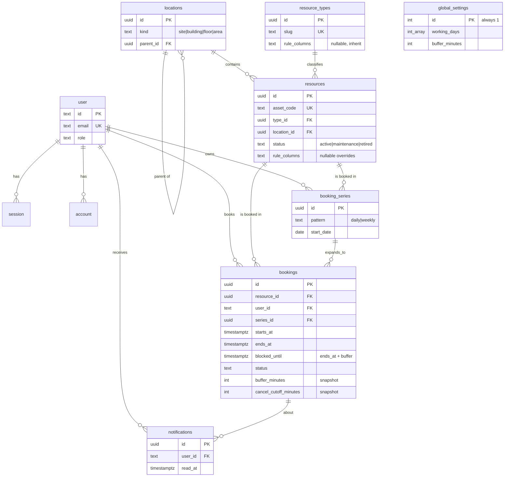

# ER diagram

Source of truth: `src/db/schema.ts` and `src/drizzle/0001_booking_constraints.sql`.
`schema.dbml` in this folder can be pasted into [dbdiagram.io](https://dbdiagram.io/d) for a shareable link.

`bookings` carries `EXCLUDE USING gist (resource_id WITH =, tstzrange(starts_at, blocked_until, '[)') WITH &&) WHERE status IN ('pending','approved')`.
`global_settings` is a single row, read through `getEffectiveRules` (resource, then type, then global).
